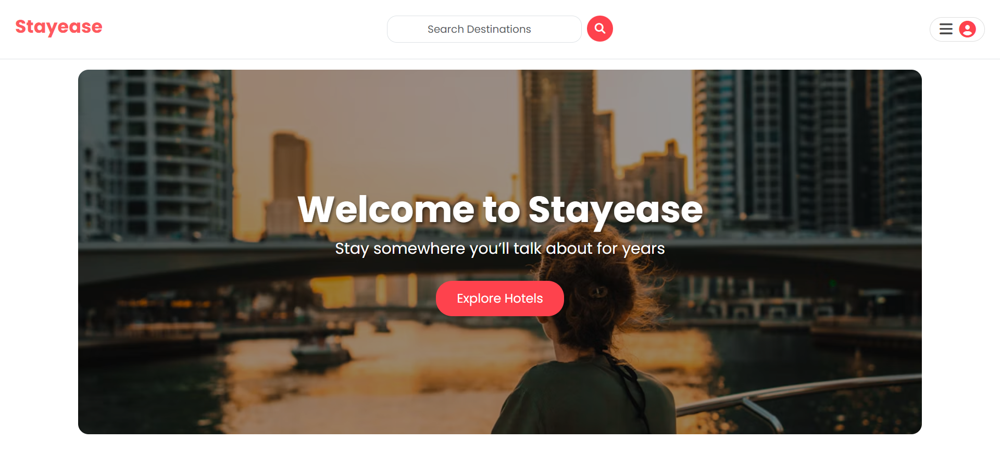
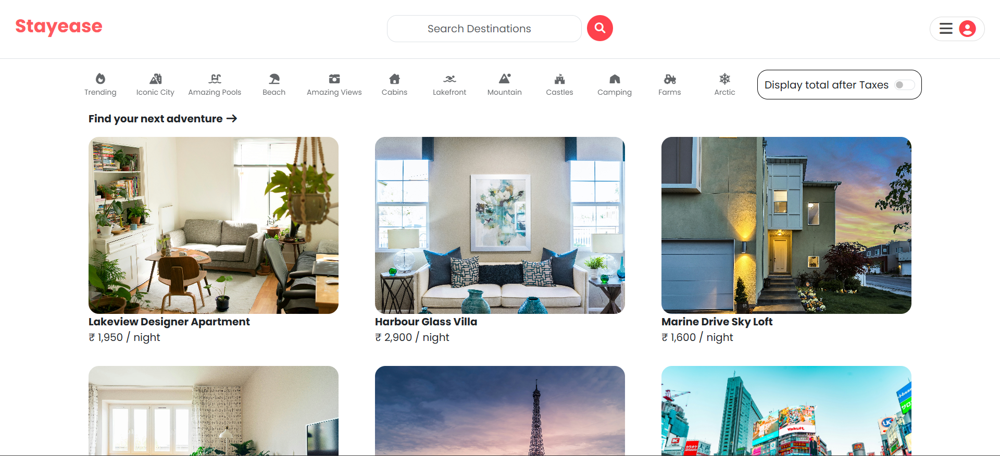

# Stayease

> Stay somewhere you'll talk about for years.

Stayease is a full-stack accommodation booking platform where travelers can discover unique stays and hosts can list their own space. It is built with Node.js, Express, MongoDB, and server-rendered EJS views.

**Live demo:** [https://stayease-fxgy.onrender.com/](https://stayease-fxgy.onrender.com/)

> **Note:** The demo is hosted on Render's free tier, so it sleeps after a period of inactivity. The first load can take 30-60 seconds while the server wakes up.



## Features

- Browse and explore stay listings
- Destination search from the home page
- Sign up, log in, and log out with secure authentication (Passport.js)
- Hosts can create, edit, and delete their own listings
- Image uploads for listings, stored on Cloudinary
- Personalized home page for logged-in users
- Responsive design that works on mobile, tablet, and desktop
- Touch-friendly interactive cards

## Key Concepts

- MVC-style structure with separate models, routes, and views
- Session-based authentication and authorization with Passport.js
- Server-side rendering with EJS and ejs-mate layouts
- Cloud image storage and delivery via Cloudinary
- Data modeling with Mongoose schemas on MongoDB Atlas

## Tech Stack

| Area | Technology |
| --- | --- |
| Backend | Node.js, Express |
| Database | MongoDB, Mongoose |
| Views | EJS, ejs-mate layouts |
| Authentication | Passport.js |
| Image storage | Cloudinary |
| Styling | Bootstrap, custom CSS, Font Awesome |
| Hosting | Render |

## Demo Account

Want to try host features without signing up? Use these credentials on the live demo:

- **Username:** `your_demo_username`
- **Password:** `your_demo_password`

## Getting Started

### Prerequisites

- Node.js 18 or later
- A MongoDB database (local or MongoDB Atlas)
- A Cloudinary account

### Installation

```bash
git clone https://github.com/ronit-patidar/StayEase.git
cd StayEase
npm install
```

### Environment variables

Copy the example file and fill in your own values:

```bash
cp .env.example .env
```

The `.env` file needs these keys:

```env
ATLASDB_URL=your_mongodb_connection_string
SECRET=your_session_secret
CLOUD_NAME=your_cloudinary_cloud_name
CLOUD_API_KEY=your_cloudinary_api_key
CLOUD_API_SECRET=your_cloudinary_api_secret
```

### Run the app

```bash
node app.js
```

Open `http://localhost:8080` in your browser.

## Project Structure

```
.
├── app.js
├── models/        # Mongoose schemas (listings, users)
├── routes/        # Express routes
├── views/         # EJS templates and layouts
├── public/
│   ├── css/       # Stylesheets (home.css and others)
│   ├── js/        # Client-side scripts (home.js and others)
│   └── images/    # Static images
├── screenshots/   # README screenshots
├── .env.example   # Template for environment variables
└── .env           # Your local environment variables (not committed)
```

## Main Routes

| Route | Description |
| --- | --- |
| `/` | Home page |
| `/listings` | Browse all listings |
| `/listings/new` | Create a new listing (hosts) |
| `/signup` | Create an account |
| `/login` | Log in |

## Screenshots

| Listings page |
| --- |
|  |


## Future Improvements

- Booking calendar and availability
- Advanced search and filters by location and price
- Payment integration


## Author

**Ronit Patidar**
GitHub: [@ronit-patidar](https://github.com/ronit-patidar)

